<div align="center">
  
  <h1>hanpath</h1>
  <p><strong>Learn Mandarin on a path that tells you what to do next — and pass the HSK.</strong></p>
  <p>
    
    
    
    
    
  </p>
</div>

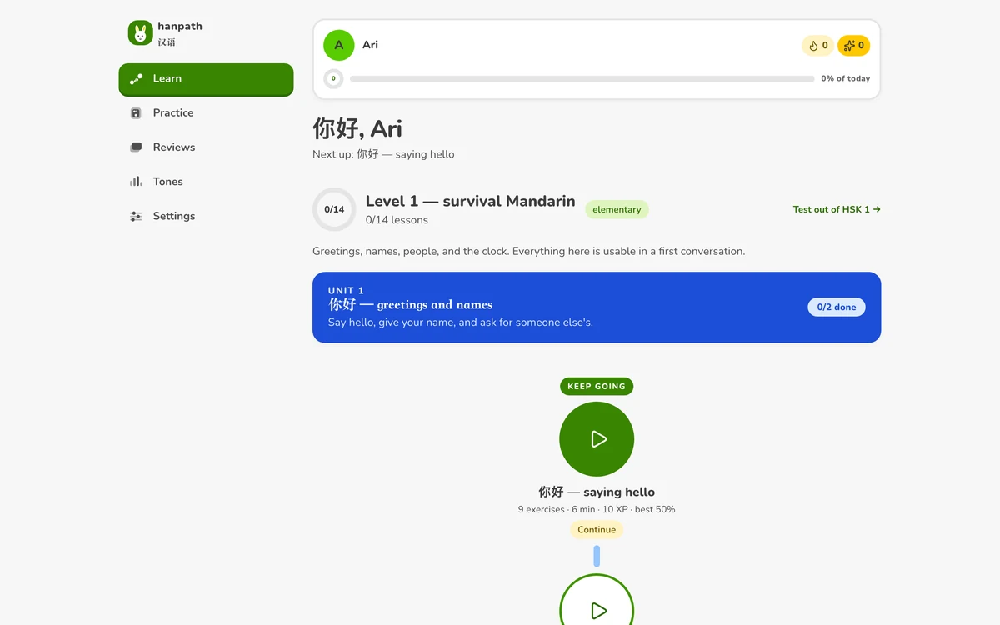

## What it is

A full-stack web app for learning Mandarin and preparing for HSK: **5 HSK 2.0 levels,
104 units, 406 lessons, 11,040 server-graded exercises and 2,386 words**, with practice
studios, spaced repetition, streaks, proficiency tests and a compact gamified shell that
works on a phone.

The curriculum is data, not code. Attempts are an append-only log, and every number the
learner sees — lesson state, XP, mastery, daily rollup, streak, review schedule — is
derived from it by one recompute path in the same transaction. The server grades; the
client renders. Nothing is judged in the browser.

**Scope, stated plainly:** mock exams are designed but not built; speaking is captured in
the browser and scored through a provider interface once one is configured — the recording is
never uploaded or stored — and it is deliberately *not* judged correct/incorrect; Hanzi
writing is graded from the client's own stroke report. `docs/roadmap.md` is the exact
account of what is and is not shipped.

---

## A tour

### The path — one screen that answers "what now?"

An open trail of lesson nodes with four distinguishable states (completed, current,
available, locked), unit banners, and a "test out" route for learners who already know a
level. The home screen *is* the path: no dashboard to interpret first.


### Lessons — 15 exercise types, graded on the server

Multiple choice, multiple answer, true/false, sentence ordering, fill-in-the-blank,
translation, listening comprehension, dictation, tone choice, read-aloud, repeat-after-model,
free answer, Hanzi tracing and recall. Answer keys are **structurally absent** from the
payload the client receives, exam mode withholds every solution until submission, and
free-form answers come back `needs_review` instead of a false "correct".

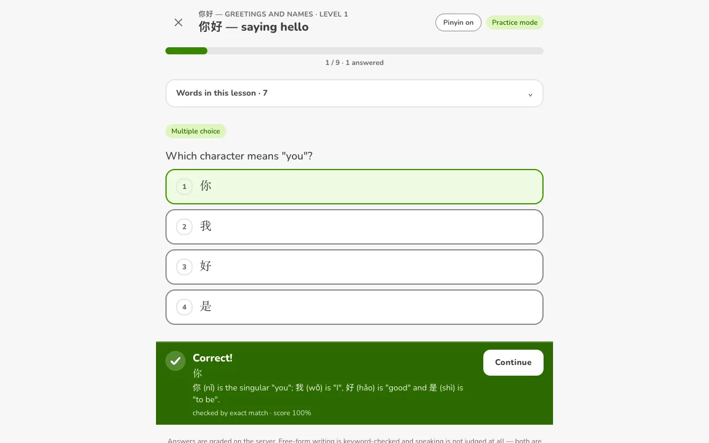

The verdict is spoken in three channels: words, colour, and a **synthesised chime** — rising
for a correct answer, falling (softer, a minor third down) for a miss, silence for an answer
awaiting review. No audio files ship; it is a few lines of Web Audio, and it has its own
`音效` toggle that persists.

### Practice studios — outside the path, on purpose

The practice hub leads to four studios. They serve drills from **any** level and state up
front that nothing there moves the path — a learner who wants to drill 写 before their
lessons reach it can, without the app pretending they learned it.

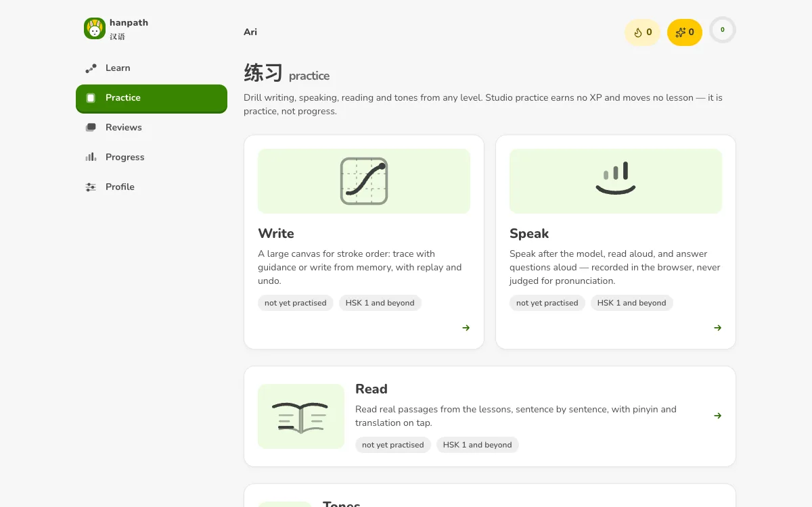

**Writing** is a full stroke-order studio: a model character, a tianzige-style guide grid,
undo/clear/replay, trace drills and from-memory recall (465 + 270 of them). Stroke data is
the Make Me a Hanzi set, shipped locally and attributed under the Arphic Public License.

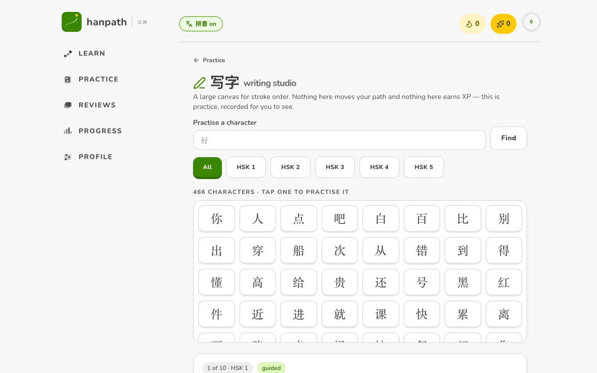

**Tones** exist as their own drill type because tones are what learners actually fail at:
choose the tone pattern without walking the path, with a tally of what you got right.

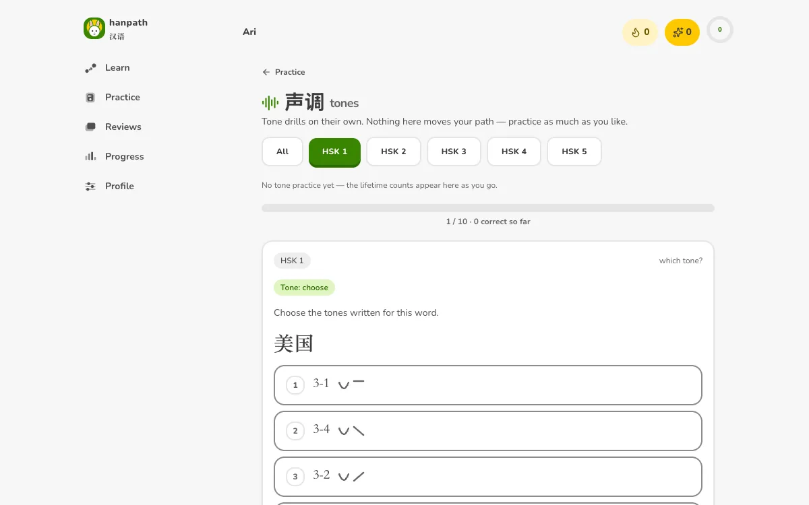

**Reading** serves passages with pinyin and translation on demand; **Speaking** records,
scores through a provider interface once configured, plays the model and your attempt back
to back, and never claims your tones were right or wrong.

<p>
  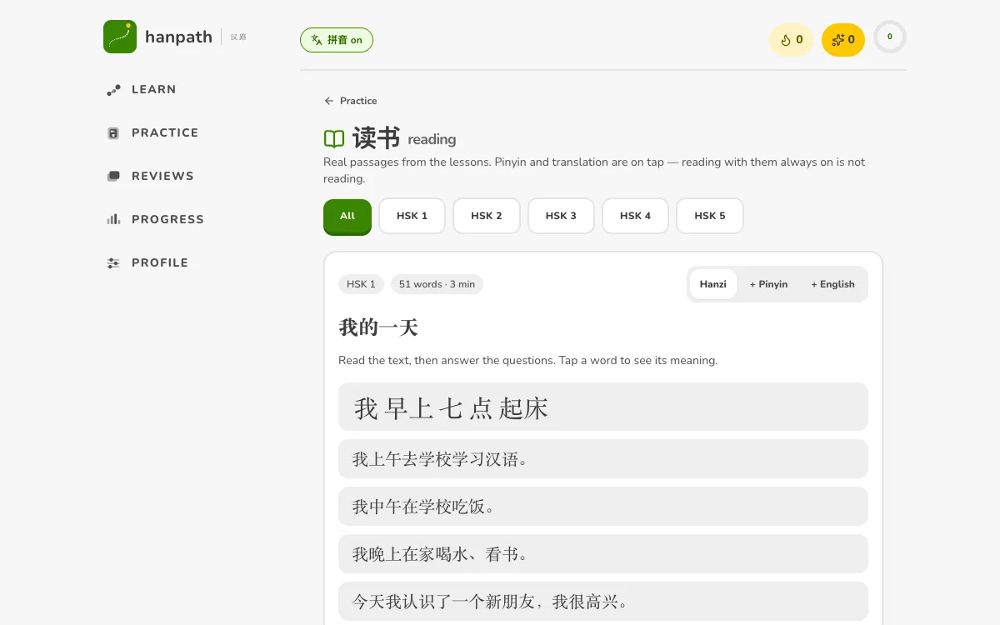
  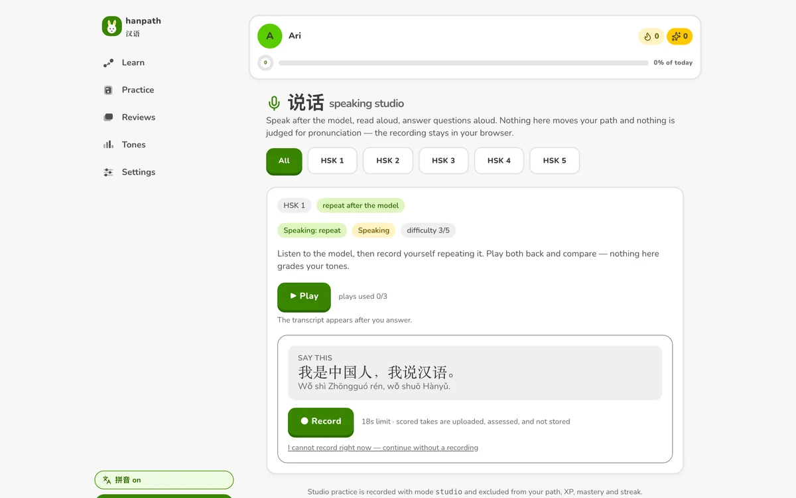
</p>

### Reviews — spaced repetition over what you actually got wrong

Every attempt feeds a review queue on an interval ladder: what is due now, what is coming,
and a session that only grades through the same registry.

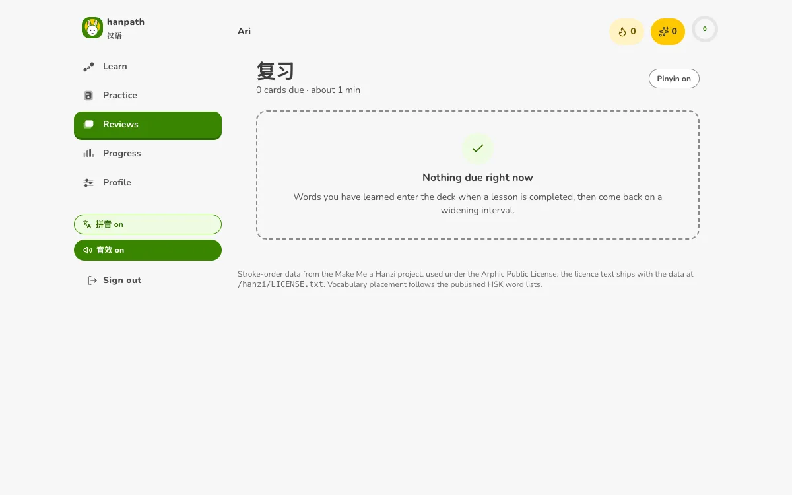

### Progress — numbers you can audit

Streak, today's goal, XP, per-skill mastery and a 30-day activity grid, all recomputed from
attempts — followed by a `Recompute` button, because the honest thing to do with derived
data is offer to derive it again. Days are bucketed by **your** IANA timezone, and a streak
requires calendar-adjacent days: opening the app does not count, meeting the daily goal does.

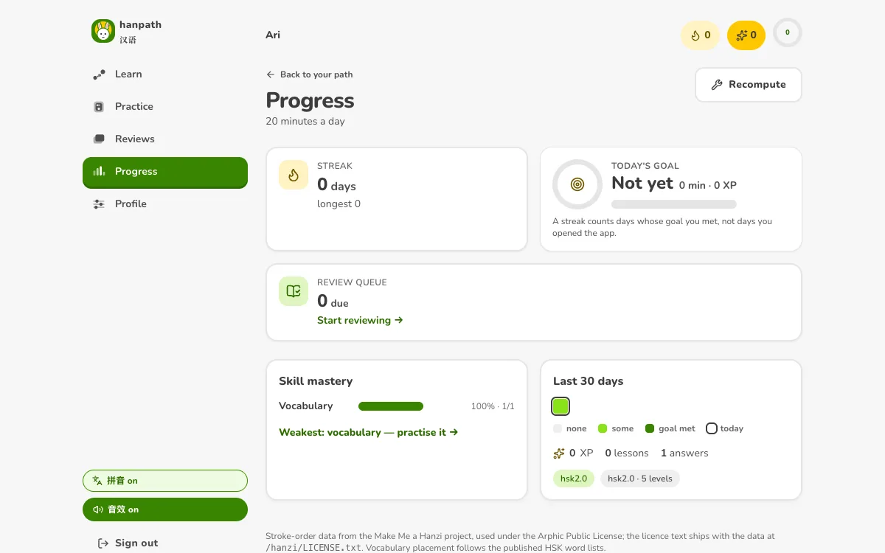

### Test out — skip a level by proving it

A paper drawn across a whole HSK level, graded by the same exercise registry. 80% or better
opens the level without marking a single lesson learned, so a false start costs an afternoon
rather than a month.

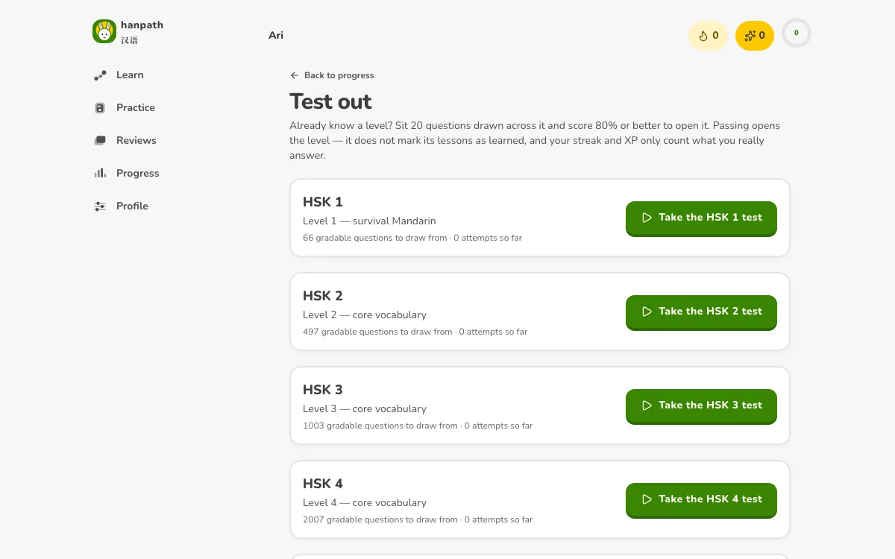

### The study guide — every word, the grammar notes, your bookmarks

Searchable vocabulary by level (character, pinyin or meaning), hand-written grammar notes
tied to the unit that teaches them, and bookmarks for the words you keep forgetting.

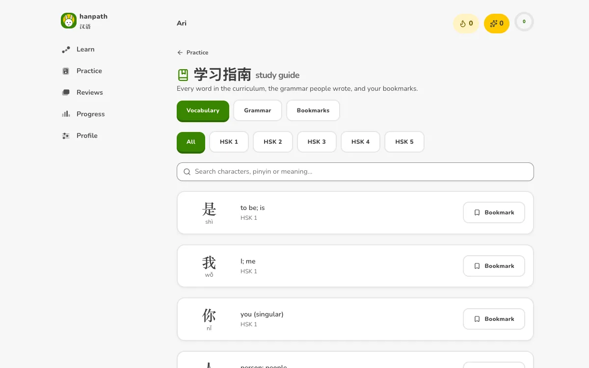

### The interface is a system, not a stylesheet

The visual language follows the OpenDesign `duolingo` design-system package — chunky fills,
a solid "clay" lip under every primary control, a two-row learner card in the header — with
one deliberate departure: **the package's own colour pairings fail WCAG, so they were
corrected rather than copied.** White on Owl Green `#58cc02` measures **2.09:1**; on
Cardinal `#ff4b4b`, **3.30:1**. Signature hues therefore carry large shapes and dark labels
(the mascot is bright Owl Green with an ink initial at 5.28:1), while white-labelled fills
use the darkened step `brand-600 #398501` at **4.64:1**.

A test computes those ratios, another refuses any `var(--color-…)` that `index.css` does not
declare, and the shell is asserted at six desktop widths plus an emulated phone: no
horizontal overflow, ≥44px touch targets, one fixed bottom bar. Type and icons are
self-hosted; nothing is fetched from a third-party CDN at runtime.

<p>
  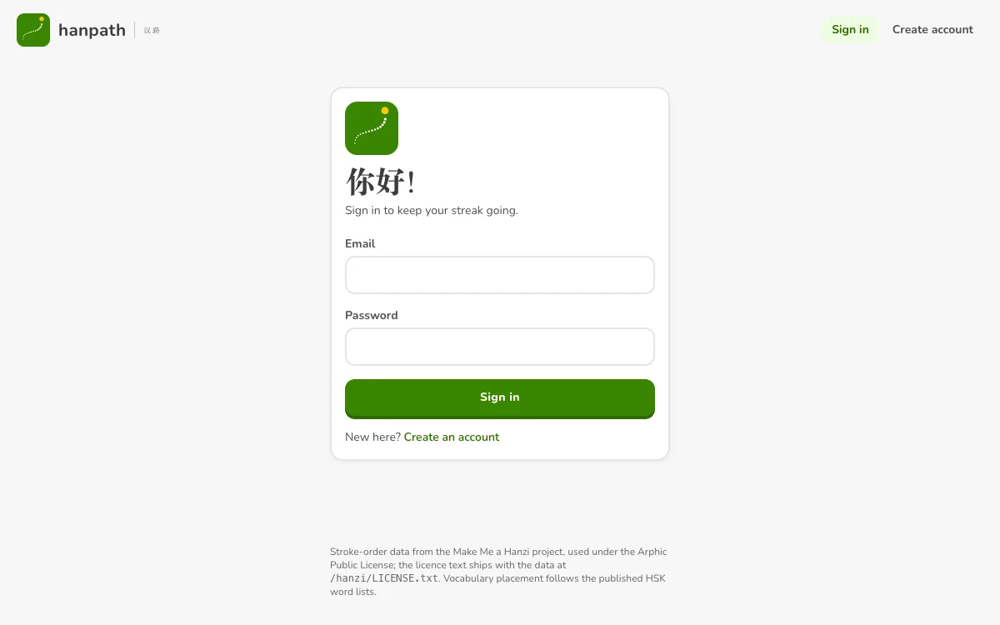
  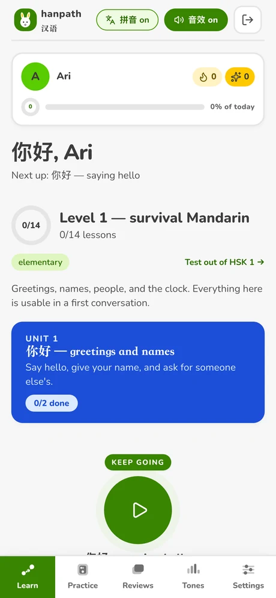
</p>

The mascot is a **moon rabbit (玉兔)** — Chang'e's companion, drawn in flat vector from
circles and capsules so it holds 32px in the header and 64px on the sign-in card. It has a
`cheer` face for welcomes, and it drops its finer features below 40px where they would only
alias.

---

## Quick start

```bash
make dev            # .env, an isolated local Postgres cluster on :5435, migrations, content import
make run-api        # API on http://127.0.0.1:8081
make web-install    # SPA dependencies + stroke-order data
make web-dev        # SPA on http://localhost:5174
make run-worker     # optional: async jobs
```

Open **http://localhost:5174**, not the API port. The SPA and the API must share an origin —
that is what the Vite proxy provides in development, and what Caddy provides in production.
Pointing the SPA at `127.0.0.1:8081` directly makes the session cookie third-party and the
browser silently drops it.

Requirements: the Go toolchain pinned in `go.mod`, Node + pnpm, and Postgres 15 or 16
(`brew install postgresql@16`). No container runtime is needed. Redis and mail are optional:
the rate limiter runs in-process and mail prints to the log unless `SMTP_ADDR` is set.

`make help` lists every target.

## What's in the curriculum

| | |
|---|---|
| levels | 5 (HSK 2.0) |
| units | 104 |
| lessons | 406 — 14 / 25 / 50 / 100 / 217 by level |
| exercises | 11,040 |
| words | 2,386 |
| exercise types | 15 |
| biggest family | listening (2,412), tone choice (2,387), multiple choice (2,349), speaking (2,346), dictation (790), Hanzi trace (465) + recall (270), and hand-authored reading/grammar items |

HSK 3.0 — three stages, nine levels — is an **import**, not a release: the importer upserts
on natural keys and never deletes an exercise, because a delete would cascade away every
learner attempt against it.

## How it works — five ideas worth knowing

1. **Attempts are the source of truth; everything else is derived.** `attempts` is an
   append-only event log. Lesson progress, XP, skill mastery, daily rollups, streaks and the
   review deck are rebuilt from it by one recompute path, called inside the submission
   transaction and again by `POST /api/v1/progress/refresh`. A stale number is one call away
   from being correct.
2. **The server grades; the client renders.** One registry validates and grades every
   exercise type; a new type cannot reach a learner without its own validator. Answer keys
   are structurally absent from lesson payloads, and a free-form answer is rubric-checked and
   flagged `needs_review` rather than declared correct.
3. **Time is the learner's, not the server's.** Streaks, daily goals and rollups are bucketed
   by the learner's timezone, and the streak walker requires calendar-adjacent days.
4. **Idempotent by construction.** Every attempt carries a `client_ref`: a retried batch is a
   no-op, and reusing a reference for a *different* exercise is a `409` rather than a
   silently swallowed answer.
5. **Curriculum is data.** Levels, units, lessons, vocabulary and exercises live in YAML under
   `content/`, validated at import time and upserted on natural keys.

## Testing

```bash
make test              # Go unit tests, no database needed
make test-integration  # Go end-to-end tests against Postgres
make smoke             # HTTP contract test against a running API
make web-test          # SPA unit and component tests (Vitest + Testing Library)
node scripts/e2e-smoke.mjs   # real browser end-to-end, needs the API and dev server up
```

The browser test drives headless Chrome over the DevTools Protocol: register → path → a
nine-exercise lesson → results → the studios → progress, then **measures the shell** at six
desktop widths (including a Retina Mac at 2×) and an emulated phone, asserting no overflow,
connectors centred, one fixed bottom bar and ≥44px targets. Overflow failures name the
offending element. It currently reports **95 passed, 0 failed, 1 skipped**.

Two opt-ins, both inside the gitignored `.local/`:

- `.local/e2e-last.log` — a transcript of every run, so a failure that scrolls past is still
  diagnosable;
- `HANPATH_E2E_SHOTS=1` — screenshots of each screen, to look at the interface the run just
  proved is functional.

The integration suite is gated on `HANPATH_TEST_DATABASE_URL`; `make test-integration` sets
it. A bare `go test ./...` skips it and proves nothing about grading or progress.

## Layout

```
cmd/api             HTTP server
cmd/worker          background jobs (session pruning, progress recomputation)
cmd/contentctl      validate / import / migrate / list curriculum content
internal/config     environment loading with fail-fast validation
internal/httpapi    routing, middleware, handlers, error envelope
internal/auth       argon2id passwords, session + CSRF tokens, rate limiting
internal/store      all SQL, plus the derived-progress recompute path
internal/exercises  the exercise registry: per-type validation and grading
internal/progress   streak maths, interval ladder, lock-state derivation
internal/curriculum the authoring format: parse, validate, idempotent import
migrations          goose migrations, embedded in the binaries
content/            authored HSK curriculum as YAML
openapi/            the API contract
integration/        end-to-end Go tests against a real database
scripts/            HTTP smoke test and browser end-to-end test
web/                React + TypeScript SPA
docs/               architecture, sources and licensing, roadmap, screenshots
```

## Configuration

All configuration is environment-based; see `.env.example`. `internal/config` refuses to
start on a missing database URL, a `Secure` cookie over plain `http`, or a production
environment without a secure cookie. Secrets are never logged.

## Documentation

| | |
|---|---|
| [`docs/README.md`](docs/README.md) | the engineering overview, in more depth |
| [`docs/architecture.md`](docs/architecture.md) | how the layers fit, and why |
| [`docs/roadmap.md`](docs/roadmap.md) | what is shipped, what is designed, what is not |
| [`docs/sources.md`](docs/sources.md) | per-source licensing and attribution obligations |
| [`openapi/openapi.yaml`](openapi/openapi.yaml) | the API contract |

The interface is built on the [OpenDesign](https://github.com/nexu-io/open-design)
`duolingo` design-system package (Apache-2.0), fetched rather than vendored — see
`design/open-design/README.md`.

## Licensing and third-party data

Stroke-order data, vocabulary placement and any derived definitions each carry their own
obligations. Those are recorded per source, with the clause that matters, in
[`docs/sources.md`](docs/sources.md). Attribution required by the Arphic Public License ships
in the app footer and next to the data itself.
